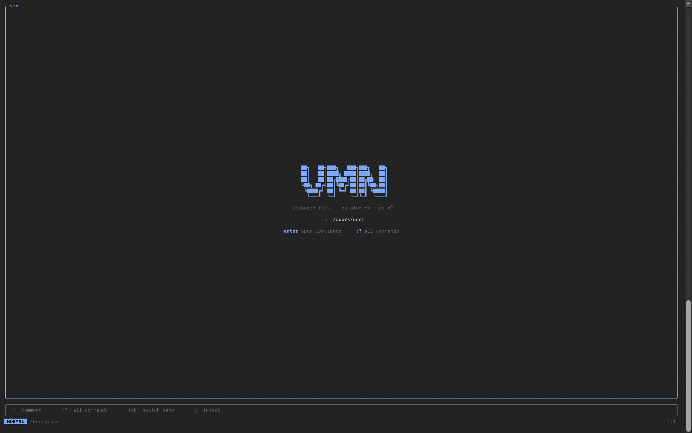
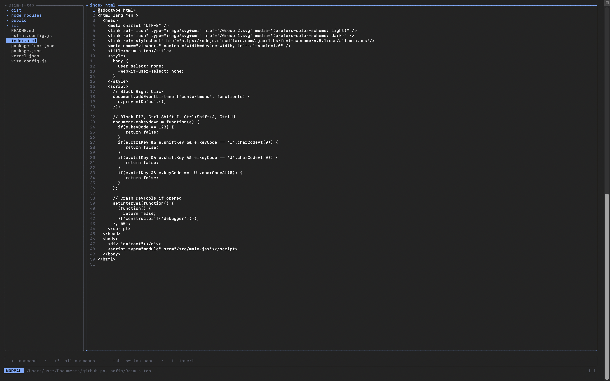

# vmn — vimini

A lightweight, keyboard-first terminal code editor for macOS. Modal editing
like Vim, a built-in file explorer, and a batteries-included live server — with
**no plugins and no AI**. One binary, one command: `vmn`.

```
  ██╗   ██╗███╗   ███╗███╗   ██╗
  ██║   ██║████╗ ████║████╗  ██║
  ██║   ██║██╔████╔██║██╔██╗ ██║
  ╚██╗ ██╔╝██║╚██╔╝██║██║╚██╗██║
   ╚████╔╝ ██║ ╚═╝ ██║██║ ╚████║
    ╚═══╝  ╚═╝     ╚═╝╚═╝  ╚═══╝
   keyboard-first · no plugins · no AI
```

---

## About

`vmn` (short for *vimini*) is built for developers who appreciate the simplicity and efficiency of modal terminal text editors but want a modern, zero-config experience. Instead of spending hours configuring plugins, writing Lua scripts, or setting up complex tools, `vmn` gives you a highly productive workspace out of the box.

### Why vmn?

- **No Plugins, No Configuration:** Key features like the visual file explorer and the live server are built directly into the editor and work immediately.
- **No AI Hype:** A pure, deterministic tool focused on providing a stable, reliable coding environment.
- **Modern TUI Aesthetics:** Powered by `ratatui` to provide clean borders, clear panels, and a responsive status bar.
- **High Performance:** Powered by Rust and `ropey` (a fast UTF-8 rope text buffer), allowing you to open and edit large source files instantly.
- **Batteries-Included Live Reload:** With `:serve`, web developers can instantly spin up a local server, watch files, and enjoy hot-reload in the browser without leaving their editor.

---

## Features

- **Modal editing** — Normal / Insert / Command modes, `hjkl` navigation.
- **Visual file explorer** — browse and open files without leaving the editor; folders expand lazily.
- **Integrated command bar** — Vim-style `:` commands, including `:cd` to move your working directory.
- **Live server** — `:serve` starts a local dev server, opens your default browser, and auto-reloads the page on every save.
- **Autosave** — your open file is written to disk every 3 seconds, with an on-screen confirmation.
- **Any text file type** — `.html`, `.rs`, `.py`, `.js`, `.css`, `.md`, whatever. (It's a text editor, not a hex/image editor.)

---

## Screenshots

### Home screen

The landing view: the `VMN` wordmark, the tagline, your current directory, and the
two entry points — `enter` to open the workspace, `:?` for the command list.



### Workspace — file explorer

Open the workspace with `enter`. The left pane is the file explorer (folders shown
with `▸` collapsed / `▾` expanded); the right pane is the editor. The focused pane
has a highlighted border. Use `Tab` to switch panes and `j`/`k` to move the selection.


### Workspace — editing a file

Press `enter` or `l` on a file to open it. Line numbers run down the gutter, the
active line's number is highlighted, and the status bar shows the mode, the working
directory, and the cursor position.



> The status bar always shows the current mode (`NORMAL` / `INSERT` / `COMMAND`),
> and the bottom hint row lists the quick keys: `:` command · `:?` all commands ·
> `tab` switch pane · `i` insert.

---

## Requirements

### System

| Requirement    | Details                                                                 |
| -------------- | ----------------------------------------------------------------------- |
| **OS**         | macOS (developed and tested on macOS 15 / Darwin 25). UNIX-like, 64-bit. |
| **Terminal**   | Any modern terminal with raw-mode + true-color (24-bit) support — Terminal.app, iTerm2, WezTerm, Alacritty, Kitty, etc. |
| **`open`**     | Built into macOS. Used by `:serve` to launch your default browser.      |
| **`date`**     | Built into macOS. Used once per session to read your local time zone for the autosave timestamp. |

No other system packages are needed — the binary is self-contained.

### Build toolchain

| Tool      | Version           | Notes                                        |
| --------- | ----------------- | -------------------------------------------- |
| **Rust**  | 1.96.0 (or newer) | Edition 2021. Install via [rustup](https://rustup.rs). |
| **Cargo** | ships with Rust   | Used to build and install.                    |

#### How to Install the Toolchain

If you do not have Rust and Cargo installed, you can set them up using the following commands:

1. **Install rustup** (the official Rust toolchain installer):
   ```bash
   curl --proto '=https' --tlsv1.2 -sSf https://sh.rustup.rs | sh
   ```
   Follow the on-screen prompts. Once completed, restart your terminal or run:
   ```bash
   source "$HOME/.cargo/env"
   ```

2. **Alternative installation (Homebrew for macOS)**:
   ```bash
   brew install rustup
   rustup-init
   ```

3. **Verify the installation**:
   ```bash
   rustc --version    # should be >= 1.96.0
   cargo --version
   ```

### Rust dependencies

These are fetched automatically by Cargo on first build — you don't install them
by hand. Listed here for reference (versions from `Cargo.lock`):

| Crate         | Version | Purpose                                  |
| ------------- | ------- | ---------------------------------------- |
| `crossterm`   | 0.28.1  | Terminal raw mode, input events, screen  |
| `ratatui`     | 0.29.0  | TUI layout and rendering                 |
| `ropey`       | 1.6.1   | Rope text buffer (fast edits, big files) |
| `anyhow`      | 1.0.103 | Error handling                           |
| `tiny_http`   | 0.12.0  | Live-server HTTP                         |
| `notify`      | 6.1.1   | Filesystem watching for live reload      |

### Network

- **None to build or edit.** Everything runs locally.
- Cargo needs internet access **once** to download crates on the first build.
- `:serve` binds a **local** port (default `3000`) on `127.0.0.1` — nothing is exposed to your network.

---

## Install

Requires the [Rust toolchain](https://rustup.rs) (`cargo`) — see [Requirements](#requirements) above.

```bash
cd vimini
cargo install --path .
```

This installs the `vmn` binary to `~/.cargo/bin`. Make sure that's on your `PATH`
(add this to `~/.zshrc` if needed):

```bash
export PATH="$HOME/.cargo/bin:$PATH"
```

Now `vmn` works from anywhere.

### Run from source without installing

```bash
cargo run --release           # opens the current directory
cargo run --release -- file   # opens a file
```

---

## Launch

```bash
vmn                # home screen, rooted at the current directory
vmn src/main.rs    # jump straight into a file
vmn ~/projects     # open with the explorer rooted there
```

---

## Tutorial

### 1. The home screen

Running `vmn` drops you on the home screen showing your current directory. From here:

| Key   | Action                     |
| ----- | -------------------------- |
| `enter` | open the workspace       |
| `:?`  | show the full command list |
| `:q`  | quit                       |

### 2. The workspace

Press `enter` to open the workspace. It has two panes:

```
┌ myproject ──────┐┌ index.html ─────────────────┐
│ ▸ src           ││   1 <!DOCTYPE html>          │
│ ▾ assets        ││   2 <html>                   │
│     style.css   ││   3   <body>                 │
│   index.html    ││ ...                          │
└─────────────────┘└──────────────────────────────┘
  press : for a command  ·  :? all commands  ·  tab switch pane
```

- **Left:** the file explorer.
- **Right:** the editor.
- Press **`Tab`** to move focus between them. The focused pane has a highlighted border.

### 3. Browsing and opening files (explorer focused)

| Key            | Action                          |
| -------------- | ------------------------------- |
| `j` / `↓`      | move down                       |
| `k` / `↑`      | move up                         |
| `enter` / `l`  | open a file, or expand a folder |
| `enter` / `l`  | collapse an expanded folder     |
| `Tab`          | switch focus to the editor      |

Folders read their contents only when you first expand them, so opening a large
project is instant.

### 4. Editing (editor focused)

vmn is modal. You start in **Normal** mode. The current mode is always shown in
the status bar at the bottom (`NORMAL`, `INSERT`, `COMMAND`).

**Normal mode** — move around:

| Key         | Action        |
| ----------- | ------------- |
| `h` / `←`   | left          |
| `j` / `↓`   | down          |
| `k` / `↑`   | up            |
| `l` / `→`   | right         |
| `i`         | enter Insert  |
| `:`         | enter Command |

**Insert mode** — type text. Press **`Esc`** to return to Normal mode.
`Enter` and `Backspace` work as expected.

A `●` next to the filename means there are unsaved changes.

### 5. Autosave

You rarely need to save manually. Every **3 seconds**, if the open file has
unsaved changes, vmn writes it to disk and shows a confirmation:

```
✓ autosaved index.html at 14:32:07
```

You can still save on demand with `:w`.

### 6. Creating files and folders

Open the command bar with `:` and type:

```
:new index.html          create a file and start editing it
:new src/app.js          missing parent folders are created for you
:mkdir assets            create a directory
```

`:new` refuses to overwrite an existing file — use `:e` to open one instead.

### 7. Moving around the filesystem

```
:cd ~/projects/site      change the working directory (accepts ~, relative, absolute)
:pwd                     print the current directory
:e about.html            open a file relative to the current directory
```

### 8. The live server

With an HTML/CSS/JS project open:

```
:serve                   serve the current directory on http://127.0.0.1:3000
                         and open it in your default browser
:serve 8080              use a specific port
:serve --no-open         start the server without opening a browser
:open                    (re)open the browser at the served URL
:serve stop              stop the server
```

While the server runs, a green `● :3000` appears in the status bar. Edit any
file, let it autosave (or press `:w`), and the browser reloads automatically —
no extension, no config.

> The browser is launched via macOS's `open`, so it reuses your running default
> browser if one is open, or launches it if not.

### 9. Getting help & going home

```
:?                       show the command list (press any key to dismiss)
:back                    return to the home screen
```

---

## Command reference

| Command            | Alias        | Description                                   |
| ------------------ | ------------ | --------------------------------------------- |
| `:new <file>`      | `:n`, `:touch` | create a file and open it in Insert mode     |
| `:e <file>`        | `:edit`      | open an existing file                         |
| `:mkdir <dir>`     |              | create a directory                            |
| `:w`               | `:write`     | save the current file now                     |
| `:wq`              |              | save and quit                                 |
| `:cd <path>`       |              | change working directory (`~`, rel, abs)      |
| `:pwd`             |              | print the working directory                   |
| `:r`               | `:refresh`   | refresh the file explorer                     |
| `:serve [port]`    |              | live server + open browser (default port 3000)|
| `:serve --no-open` |              | live server without opening a browser         |
| `:serve stop`      |              | stop the live server                          |
| `:open`            | `:o`         | open the browser at the served URL            |
| `:?`               | `:help`, `:h`| show the command list                         |
| `:back`            | `:b`         | return to the home screen                     |
| `:q`               | `:quit`      | quit                                          |

**Global keys:** `Ctrl-C` quits from anywhere. `Esc` leaves Insert/Command mode.

---

## Project layout

```
vimini/
├── Cargo.toml            # crate + [[bin]] name = "vmn"
├── README.md
├── src/
│   ├── main.rs           # entry point, event loop, key handling
│   ├── lib.rs            # library surface (exposes the server for tests)
│   ├── app.rs            # editor state: buffer, explorer, cwd, modes, commands
│   ├── ui.rs             # rendering: home, workspace, help, status bar
│   └── server.rs         # live server + file watcher + browser launch
└── tests/
    └── live_server.rs    # integration tests for the live server
```

Built with [ratatui](https://ratatui.rs) (TUI), [crossterm](https://github.com/crossterm-rs/crossterm)
(terminal), [ropey](https://github.com/cessen/ropey) (text buffer),
[tiny_http](https://github.com/tiny-http/tiny-http) and
[notify](https://github.com/notify-rs/notify) (live server).

---

## Running the tests

```bash
cargo test --release
```

Covers the live server end-to-end: HTML serving, reload-script injection, the
file-change reload signal, path-traversal rejection, and 404s.

---

## Status & roadmap

Working today: modal editing, file explorer, command bar, live server with
auto-reload and browser launch, autosave.

Planned:

- Syntax highlighting (tree-sitter)
- Inline diagnostics / Error Lens (LSP)
- Basic autocompletion

## Notes & limitations

- **macOS-focused.** The `:serve` browser launch uses macOS's `open`.
- **Text only.** The buffer is UTF-8 text; binary files (images, etc.) won't render meaningfully.
- Autosave writes in place. It does not keep a separate backup file.
