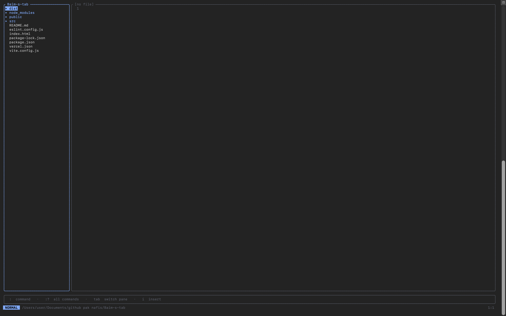

# vmn — vimini

A lightweight, keyboard-first terminal code editor for macOS. Modal editing
like Vim, a built-in file explorer, and a batteries-included live server — with
**no plugins and no AI**. One binary, one command: `vmn`.

```
  ██╗   ██╗███╗   ███╗███╗   ██╗
  ██║   ██║████╗ ████║████╗  ██║
  ██║   ██║██╔████╔██║██╔██╗ ██║
  ╚██╗ ██╔╝██║╚██╔╝██║██║╚██╗██║
   ╚████╔╝ ██║ ╚═╝ ██║██║ ╚████║
    ╚═══╝  ╚═╝     ╚═╝╚═╝  ╚═══╝
   keyboard-first · no plugins · no AI
```

---

## About

`vmn` (short for *vimini*) is built for developers who appreciate the simplicity and efficiency of modal terminal text editors but want a modern, zero-config experience. Instead of spending hours configuring plugins, writing Lua scripts, or setting up complex tools, `vmn` gives you a highly productive workspace out of the box.

### Why vmn?

- **No Plugins, No Configuration:** Key features like the visual file explorer and the live server are built directly into the editor and work immediately.
- **No AI Hype:** A pure, deterministic tool focused on providing a stable, reliable coding environment.
- **Modern TUI Aesthetics:** Powered by `ratatui` to provide clean borders, clear panels, and a responsive status bar.
- **High Performance:** Powered by Rust and `ropey` (a fast UTF-8 rope text buffer), allowing you to open and edit large source files instantly.
- **Batteries-Included Live Reload:** With `:serve`, web developers can instantly spin up a local server, watch files, and enjoy hot-reload in the browser without leaving their editor.

---

## Features

- **Modal editing** — Normal / Insert / Command modes, `hjkl` navigation.
- **Visual file explorer** — browse and open files without leaving the editor; folders expand lazily.
- **Integrated command bar** — Vim-style `:` commands, including `:cd` to move your working directory.
- **Integrated terminal** — a real PTY running your own `$SHELL`, right in the workspace. Full ANSI/VT emulation, so `git`, `npm`, `vim`, `htop` all work.
- **Live server** — `:serve` starts a local dev server, opens your default browser, and auto-reloads the page on every save.
- **Autosave** — your open file is written to disk every 3 seconds, with an on-screen confirmation.
- **Any text file type** — `.html`, `.rs`, `.py`, `.js`, `.css`, `.md`, whatever. (It's a text editor, not a hex/image editor.)
- **Automatic Markdown preview** — any `.md` file (open one, or jump to `README.md` with `:readme`) shows rendered: styled headings, bold/italic, code blocks, and lists — no toggle needed. Click anywhere in it (or press `i`) to edit the raw text, cursor placed where you clicked; the preview comes back when you leave the editor.
- **Mouse support** — click a file in the explorer to open or expand it, click anywhere in the editor to place the cursor, and use the scroll wheel / trackpad to scroll whichever pane is under the pointer (including the README preview).

---

## Screenshots

### Home screen

The landing view: the `VMN` wordmark, the tagline, your current directory, and the
two entry points — `enter` to open the workspace, `:?` for the command list.


### Workspace — file explorer

Open the workspace with `enter`. The left pane is the file explorer (folders shown
with `▸` collapsed / `▾` expanded); the right pane is the editor. The focused pane
has a highlighted border. Use `Tab` to switch panes and `j`/`k` (or a click) to move
the selection.



### Workspace — editing a file

Press `enter` or `l` on a file to open it. Line numbers run down the gutter, the
active line's number is highlighted, and the status bar shows the mode, the working
directory, and the cursor position.


> The status bar always shows the current mode (`NORMAL` / `INSERT` / `COMMAND`),
> and the bottom hint row lists the quick keys: `:` command · `:?` all commands ·
> `tab` switch pane · `ctrl-t` terminal · `i` insert.

### Markdown preview

Open any `.md` file and it shows rendered — headings, **bold**, `code`, bullets —
with the Markdown symbols hidden. Click anywhere (or press `i`) to edit the raw
text; the preview returns when you leave the editor.

---

## Install

**What you need:** a Mac (Apple Silicon or Intel) and any terminal app —
Terminal.app, iTerm2, WezTerm, Alacritty, Kitty… Nothing else: no Rust, no
Homebrew, no extra packages.

1. Download **`vmn-macos.zip`** and unzip it.
2. Run the installer **once**:

   ```bash
   cd vmn-macos
   ./install.sh
   ```

   It may ask for your password (to copy `vmn` into `/usr/local/bin`).

3. That's it. From now on, in any terminal, just type:

   ```bash
   vmn
   ```

> **macOS says vmn "can't be opened"?** `install.sh` normally prevents this. If
> it still happens, run `xattr -d com.apple.quarantine /usr/local/bin/vmn` once.

**Uninstall:** `sudo rm /usr/local/bin/vmn` (or `rm ~/.local/bin/vmn` if the
installer put it there).

---

## Launch

```bash
vmn                # home screen, rooted at the current directory
vmn src/main.rs    # jump straight into a file
vmn README.md      # Markdown files open as a rendered preview
vmn ~/projects     # open with the explorer rooted there
```

---

## Tutorial

### 1. The home screen

Running `vmn` drops you on the home screen showing your current directory. From here:

| Key   | Action                     |
| ----- | -------------------------- |
| `enter` | open the workspace       |
| `:?`  | show the full command list |
| `:q`  | quit                       |

### 2. The workspace

Press `enter` to open the workspace. It has two panes:

```
┌ myproject ──────┐┌ index.html ─────────────────┐
│ ▸ src           ││   1 <!DOCTYPE html>          │
│ ▾ assets        ││   2 <html>                   │
│     style.css   ││   3   <body>                 │
│   index.html    ││ ...                          │
└─────────────────┘└──────────────────────────────┘
  press : for a command  ·  :? all commands  ·  tab switch pane
```

- **Left:** the file explorer.
- **Right:** the editor.
- Press **`Tab`** to move focus between them. The focused pane has a highlighted border.

### 3. Browsing and opening files (explorer focused)

| Key            | Action                          |
| -------------- | ------------------------------- |
| `j` / `↓`      | move down                       |
| `k` / `↑`      | move up                         |
| `enter` / `l`  | open a file, or expand a folder |
| `enter` / `l`  | collapse an expanded folder     |
| click          | select + open a file / toggle a folder |
| scroll wheel   | scroll the file list            |
| `Tab`          | switch focus to the editor      |

Folders read their contents only when you first expand them, so opening a large
project is instant.

### 4. Editing (editor focused)

vmn is modal. You start in **Normal** mode. The current mode is always shown in
the status bar at the bottom (`NORMAL`, `INSERT`, `COMMAND`).

**Normal mode** — move around:

| Key         | Action        |
| ----------- | ------------- |
| `h` / `←`   | left          |
| `j` / `↓`   | down          |
| `k` / `↑`   | up            |
| `l` / `→`   | right         |
| click       | put the cursor there |
| scroll wheel | scroll the file |
| `i`         | enter Insert (leaves a Markdown preview) |
| `:`         | enter Command |

**Insert mode** — type text. Press **`Esc`** to return to Normal mode.
`Enter` and `Backspace` work as expected.

A `●` next to the filename means there are unsaved changes.

**Mouse:** click any file or folder in the explorer to open/expand it, click
anywhere in the editor to place the cursor there, and scroll with the mouse
wheel or trackpad over either pane (3 lines per notch) — the wheel scrolls
whichever pane is under the pointer without changing focus. Handy alongside
hjkl/arrows, not a replacement for them.

### 5. Autosave

You rarely need to save manually. Every **3 seconds**, if the open file has
unsaved changes, vmn writes it to disk and shows a confirmation:

```
✓ autosaved index.html at 14:32:07
```

You can still save on demand with `:w`.

### 6. Creating files and folders

Open the command bar with `:` and type:

```
:new index.html          create a file and start editing it
:new src/app.js          missing parent folders are created for you
:mkdir assets            create a directory
```

`:new` refuses to overwrite an existing file — use `:e` to open one instead.

### 7. Moving around the filesystem

```
:cd ~/projects/site      change the working directory (accepts ~, relative, absolute)
:pwd                     print the current directory
:e about.html            open a file relative to the current directory
```

### 8. The integrated terminal

Press **`Ctrl-t`** (or run `:term`) anywhere in the workspace to open a terminal
panel across the bottom. It starts your own login shell (`$SHELL`, falling back
to `/bin/zsh`) in the current working directory.

```
┌ src ────────────┐┌ main.rs ─────────────────────┐
│   main.rs       ││   1 fn main() {              │
│   app.rs        ││   2     println!("hi");      │
└─────────────────┘└──────────────────────────────┘
┌ terminal ────────────────────────────────────────┐
│ ~/project $ git status                           │
│ On branch main                                   │
│ ~/project $ ▮                                    │
└──────────────────────────────────────────────────┘
```

This is a **real PTY**, not a command box — full ANSI/VT emulation, so
interactive and full-screen programs work normally:

```bash
git status
npm run build
vim notes.txt      # yes, vim inside vmn
htop
```

**While the terminal is focused, every keystroke goes to the shell** — including
`Tab` for completion, `Ctrl-C` to interrupt a running program, `Ctrl-D`, and
arrow keys for history. The one exception is `Ctrl-t`, which is always
intercepted so you can get back out.

| Key            | Action                                        |
| -------------- | --------------------------------------------- |
| `Ctrl-t`       | open the terminal (focused) / close it        |
| `Ctrl-C`       | sent to the shell — interrupts the running command, does **not** quit vmn |
| `exit`, `Ctrl-D` | ends the shell; the panel closes itself     |

The panel resizes the PTY to match its size, so line wrapping and full-screen
apps lay out correctly. Closing the panel ends the shell session — reopening
starts a fresh one.

> While the terminal is open, vmn redraws more frequently (every 30 ms instead
> of 250 ms) so shell output appears promptly.

### 9. The README / Markdown preview

```
:readme                  open README.md from the current directory
```

There's nothing to toggle: every `.md` file opens as a rendered preview —
headings, **bold**/*italic*, `inline code`, shaded code blocks, lists,
blockquotes, and `---` rules, with the Markdown symbols hidden. Press **`i`**
or **click anywhere in it** to edit the raw text; the cursor lands where you
clicked. When you move focus away from the editor (`Tab`, the explorer, the
terminal), the preview returns automatically.

### 10. The live server

With an HTML/CSS/JS project open:

```
:serve                   serve the current directory on http://127.0.0.1:3000
                         and open it in your default browser
:serve 8080              use a specific port
:serve --no-open         start the server without opening a browser
:open                    (re)open the browser at the served URL
:serve stop              stop the server
```

While the server runs, a green `● :3000` appears in the status bar. Edit any
file, let it autosave (or press `:w`), and the browser reloads automatically —
no extension, no config.

> The browser is launched via macOS's `open`, so it reuses your running default
> browser if one is open, or launches it if not.

### 11. Getting help & going home

```
:?                       show the command list (press any key to dismiss)
:back                    return to the home screen
```

---

## Command reference

| Command            | Alias        | Description                                   |
| ------------------ | ------------ | --------------------------------------------- |
| `:new <file>`      | `:n`, `:touch` | create a file and open it in Insert mode     |
| `:e <file>`        | `:edit`      | open an existing file                         |
| `:mkdir <dir>`     |              | create a directory                            |
| `:w`               | `:write`     | save the current file now                     |
| `:wq`              |              | save and quit                                 |
| `:cd <path>`       |              | change working directory (`~`, rel, abs)      |
| `:pwd`             |              | print the working directory                   |
| `:r`               | `:refresh`   | refresh the file explorer                     |
| `:serve [port]`    |              | live server + open browser (default port 3000)|
| `:serve --no-open` |              | live server without opening a browser         |
| `:serve stop`      |              | stop the live server                          |
| `:term`            | `:terminal`, `:t` | toggle the integrated terminal (same as `Ctrl-t`) |
| `:readme`          |              | open `README.md` (Markdown files preview automatically) |
| `:open`            | `:o`         | open the browser at the served URL            |
| `:?`               | `:help`, `:h`| show the command list                         |
| `:back`            | `:b`         | return to the home screen                     |
| `:q`               | `:quit`      | quit                                          |

**Global keys:** `Ctrl-t` toggles the terminal from anywhere. `Ctrl-C` quits —
_except_ when the terminal is focused, where it's sent to the shell instead.
`Esc` leaves Insert/Command mode.

---

## Status & roadmap

Working today: modal editing, file explorer, command bar, integrated PTY
terminal, live server with auto-reload and browser launch, autosave,
automatic Markdown/README preview, mouse support (click to select/open in the
explorer, click to position the cursor in the editor, wheel scrolling), and a
prebuilt universal binary with a one-time installer.

Planned:

- Syntax highlighting (tree-sitter)
- Inline diagnostics / Error Lens (LSP)
- Basic autocompletion

## Notes & limitations

- **macOS-focused.** The `:serve` browser launch uses macOS's `open`.
- **Text only.** The buffer is UTF-8 text; binary files (images, etc.) won't render meaningfully.
- Autosave writes in place. It does not keep a separate backup file.
- **Mouse capture vs. text selection.** Because vmn handles clicks and scrolling
  itself, your terminal's own click-and-drag text selection is captured too. To
  select/copy text the usual way, hold **⌥ Option** while dragging in iTerm2, or
  toggle **View → Allow Mouse Reporting** (⌘R) in Terminal.app.
- **The wheel doesn't scroll the terminal panel.** Shell scrollback isn't kept;
  the wheel only scrolls the explorer and editor.
- **Markdown preview is intentionally simple** — one rendered line per source
  line, no nested emphasis, tables, or images (`` shows as text).
- **`:serve` stays on your machine.** It listens on `127.0.0.1` only (default
  port `3000`) — nothing is exposed to your network.

---

Want to build or change vmn yourself? See [DEVELOPMENT.md](DEVELOPMENT.md).
